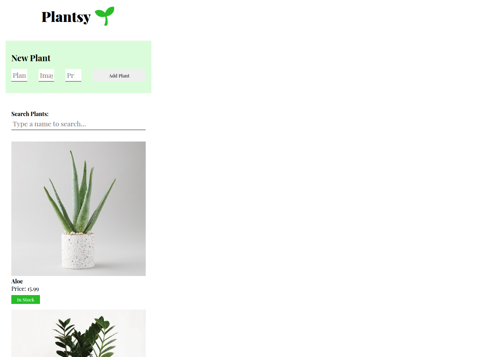

# Plantsy

Plantsy is a React plant inventory application. It loads a catalog from a local JSON Server API and lets administrators add plants, mark plants as sold out, and search the catalog by name.

## Screenshot



## Features

- Loads the complete plant catalog on initial page render
- Adds a new plant through the `New Plant` form
- Sends plant creation and stock updates to JSON Server
- Updates the inventory immediately in the React UI
- Filters plants by name as the search query changes
- Restores the full catalog when the search query is cleared
- Includes Vitest and Testing Library coverage for each deliverable

## Built With

- React 18
- Vite
- JSON Server
- Vitest
- Testing Library

## Requirements

- Node.js 18 or newer
- npm

## Installation

Clone the repository and install dependencies:

```bash
npm install
```

## Usage

Start JSON Server in one terminal:

```bash
npm run server
```

The API is available at `http://localhost:6001`. The plant collection is at `http://localhost:6001/plants`.

Start the Vite development server in a second terminal:

```bash
npm run dev
```

Open the local URL shown by Vite. Vite normally uses `http://localhost:5173` if that port is available.

## API

| Method | Endpoint | Purpose |
|---|---|---|
| `GET` | `/plants` | Retrieve the complete plant catalog |
| `POST` | `/plants` | Create a plant |
| `PATCH` | `/plants/:id` | Set `isInStock` to `false` |

A new plant uses the following JSON shape:

```json
{
  "name": "Aloe",
  "image": "./images/aloe.jpg",
  "price": "15.99"
}
```

## Testing

Run the complete suite once:

```bash
npm run test -- --run
```

Run tests in watch mode:

```bash
npm run test
```

## Project Structure

- `src/components/App.jsx` - application shell
- `src/components/PlantPage.jsx` - catalog, search state, and API mutations
- `src/components/NewPlantForm.jsx` - controlled submission flow for new plants
- `src/components/Search.jsx` - controlled search input
- `src/components/PlantList.jsx` - maps filtered plants into cards
- `src/components/PlantCard.jsx` - individual plant presentation and stock button
- `src/__tests__/` - Vitest component and behavior tests
- `db.json` - local JSON Server data

## Development Notes

Keep catalog and search state in `PlantPage`, because it is the nearest shared owner for `NewPlantForm`, `Search`, and `PlantList`. Fetch catalog data once after mount with `useEffect`, and pass mutation callbacks down as props so state changes remain predictable.

Do not commit `.env` files or credentials. The repository `.gitignore` already excludes environment files and common local build, dependency, and log directories.

## Contributing

Create a feature branch for each change, keep commits focused, run the test suite, and open a pull request into `main`.

## License

No license is currently specified for this project.
